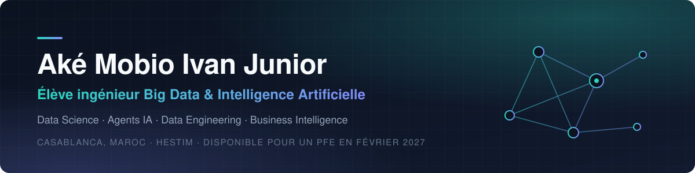

  

  
  
  

---

### À propos

Élève ingénieur en **Big Data & Intelligence Artificielle** à HESTIM (Casablanca). Je conçois des **agents IA** qui automatisent des processus métier et des **modèles de Machine Learning** qui transforment les données en décisions, du prototype jusqu'à la mise en production.

**Lauréat de la 1ère place nationale du DataTour 2026** (Data Afrique Hub × Fatala), compétition africaine de data science, en détection de fraude.

Actuellement à la recherche d'un **stage de fin d'études (PFE)** en Data Science / Data Analysis à partir de **février 2027**.

### Expérience récente

| Période | Organisation | Réalisation |
|:--|:--|:--|
| 2026 | **Holokia** · Casablanca | Plateforme d'automatisation interne composée de 5 agents IA (ATS, comptes rendus, veille, entretien, agent directeur), utilisée par la direction |
| 2026 | **ScreenEdge Africa** | Agent autonome de collecte des listes de sanctions (OFAC, ONU, CNASNU) pour le screening AML/KYC |
| 2026 | **DataTour 2026** · 1ère place nationale | Détection de fraude sur données financières : ensemble LightGBM / XGBoost / CatBoost, calibration des probabilités |
| 2023 | **Guichet Unique du Commerce Extérieur** | Intégration de données multi-sources dans un Data Warehouse, tableaux de bord Power BI |

### Compétences techniques

| Domaine | Outils |
|:--|:--|
| **Data Science & ML** |        |
| **IA générative & Agents** |      |
| **Données & BI** |       |
| **Apps & Web** |      |
| **DevOps & Cloud** |     |

### Certifications

| Certification | Organisme | Date |
|:--|:--|:--|
| Data Visualization with Python | IBM · Coursera | Juin 2026 |
| Data Analysis with Python | IBM · Coursera | Mai 2026 |
| Machine Learning with Python | IBM · Coursera | Mars 2026 |
| Data Science Methodology | IBM · Coursera | Février 2026 |
| Tools for Data Science | IBM · Coursera | Janvier 2026 |
| What is Data Science? | IBM · Coursera | Novembre 2025 |

### Formation

**HESTIM**, Casablanca · Cycle ingénieur Big Data & IA · 2024 – 2027 
**HETEC**, Abidjan · Licence professionnelle Sciences & Technologie · 2021 – 2023
